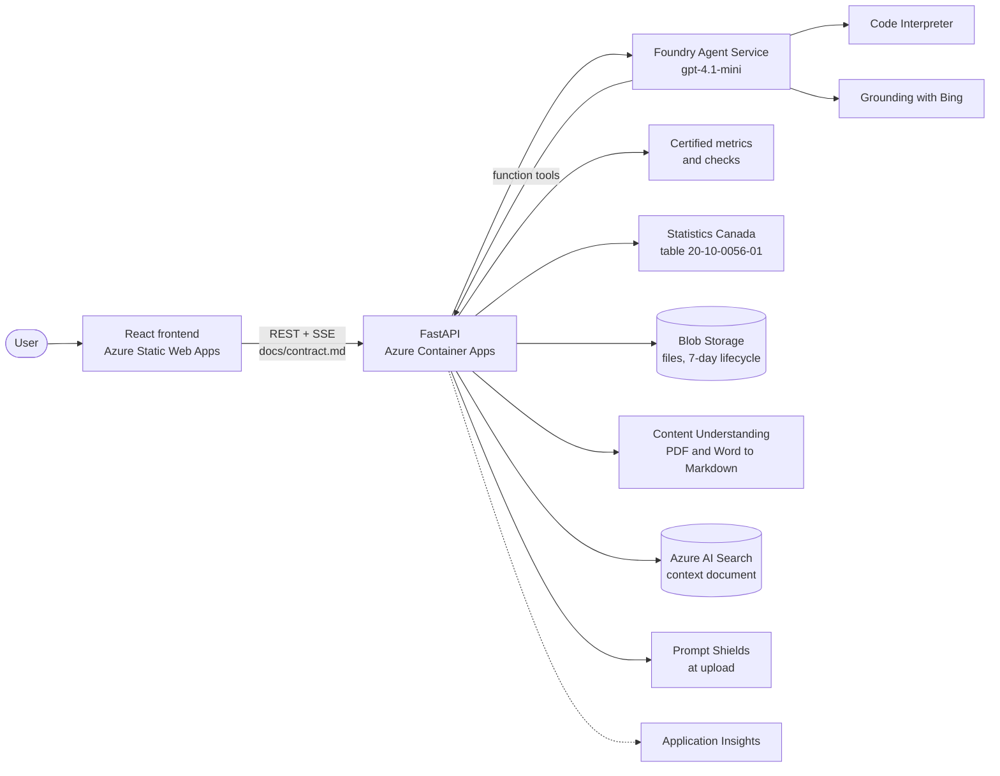

<picture>
  <source media="(prefers-color-scheme: dark)" srcset="docs/brand/oyeva-logo.svg">
  
</picture>

[](https://github.com/Cedric0518/oyeva-sales/actions/workflows/ci.yml)

An AI sales analyst for retailers, built on Microsoft Foundry. Upload a sales file (CSV or Excel)
and, if you have one, a document about your business. Ask questions in plain English. Every number
comes from code, every explanation shows where it comes from, and your sales are compared with the
retail trade of your province (Statistics Canada).

> **Status: under construction.** First complete version (v2.0) targeted for November 2026.
> Progress is tracked in the [issues](https://github.com/Cedric0518/oyeva-sales/issues) and the
> [project board](https://github.com/Cedric0518/oyeva-sales/projects).
> This is the successor of [mini-data-science-assistant](https://github.com/Cedric0518/mini-data-science-assistant)
> (v1, a local agent with MCP tools).

## What makes it different

Most "chat with your data" tools let the model produce numbers. Oyeva Sales labels the origin of
everything it says:

| Label | Where it comes from |
|---|---|
| **Certified** | A tested function with a fixed, versioned definition (sales, growth, top customers, lost customers, average basket, target attainment...). It refuses rather than guesses when a column is missing. |
| **Exploratory** | Code the agent wrote for this question, run in Code Interpreter. The code is shown. |
| **Market** | Statistics Canada, monthly retail trade of your province, fetched by code. The answer names the benchmark and the latest month published. |
| **Your documents** | Your own document (Markdown, PDF or Word). The answer cites the section, or says the document does not cover the question. |
| **Context** | The web, in words only. Never a number in a chart. |

Before any question, the upload is checked: column roles, duplicate rows, months without sales,
customers written several ways, amounts that do not match quantity times price, dates out of
range, placeholder customers such as "Walk-in", returns.

The reasons behind these choices are written down in [docs/decisions](docs/decisions).

## Architecture



- The API runs the certified functions and the document search; Foundry runs Code Interpreter and
  Bing.
- No keys anywhere: managed identity and `DefaultAzureCredential`.
- Retrieval runs on the context document only, never on the sales file. Short documents go into
  the conversation whole; longer ones are searched (hybrid search, then reranking).

## Repository layout

```
api/            FastAPI app, agent loop, certified metrics, checks, market, documents (RAG)
tests/          unit tests on small files computed by hand, regression tests on Atlas
evals/          evaluation cases, data and reports; sample data in evals/data/atlas/
frontend/       React 19, Vite, TypeScript, ECharts
docs/           API contract and decision records
scripts/        small scripts (access check, agent trials, GitHub setup)
infra/          later: infrastructure as code
```

## Sample data

[`evals/data/atlas/`](evals/data/atlas) holds Atlas General Store, a fictional Ontario retailer:
two years of order lines, monthly targets, company notes in Markdown, Word and PDF, planted
stories and defects, and the reference answers the evaluation suite checks against. Everything is
generated by a script with a fixed seed.

## How this repository is run

Work is planned in issues, grouped in the milestone of the next version and tracked on the project
board. Each change goes through a pull request that runs the checks and closes its issue. Any
change to a prompt, a model or the retrieval comes with before and after measurements. Details in
[CONTRIBUTING.md](CONTRIBUTING.md).

## License

[MIT](LICENSE)
